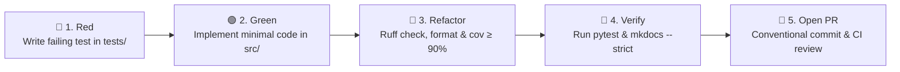

# Contributing to Paslood

Thank you for your interest in contributing to **Paslood**! 🎉

Paslood is a privacy-first, local-first strategic asset allocation and personal wealth planning platform. We welcome contributions from developers, designers, and automated agents.

---

## 1. Core Principles & Privacy Pledge

- **Local-First & Absolute Privacy**: Paslood runs on the user's local machine. We do not transmit financial data to third-party tracking services. Never hardcode credentials, private account numbers, or real balances in code, tests, or documentation.
- **Clean Architecture Integrity**: We strictly adhere to Hexagonal / Clean Architecture. Domain entities must remain pure Python dataclasses with zero framework dependencies.
- **Test-Driven Development (TDD)**: Every bug fix and feature addition must include automated tests in `tests/`.

---

## 2. Getting Started

### Prerequisites
- **Python 3.12+** (Python 3.14 recommended)
- **uv** (ultra-fast package installer and tool runner): [Install uv](https://docs.astral.sh/uv/getting-started/installation/)
- **Git**

### One-Click Devcontainer / GitHub Codespaces
If you use VSCode or GitHub Codespaces, Paslood comes pre-configured with a complete container environment:
- Open the repository in VSCode and click **"Reopen in Container"** when prompted, or create a Codespace on GitHub.
- Dependencies, Python, `uv`, and extensions (Ruff, Python, Copilot) install automatically.

### Local Installation (via `uv`)
```bash
# 1. Clone the repository
git clone https://github.com/tiwu/paslood.git
cd paslood

# 2. Synchronize all dependencies and development tools
uv sync --all-extras --dev

# 3. Verify tests and linting
uv run pytest
uv run ruff check src tests
```

---

## 3. Development Workflow

We follow the **Red-Green-Refactor** workflow:



1. **Create a branch**:
   ```bash
   git checkout -b feature/your-feature-name
   # or
   git checkout -b fix/issue-description
   ```

2. **Write tests first (🔴 Red)**:
   Add tests in `tests/unit/`, `tests/integration/`, or `tests/delivery/` capturing the desired behavior. Confirm the test fails:
   ```bash
   uv run pytest tests/path/to/test.py
   ```

3. **Implement the code (🟢 Green)**:
   Make targeted changes in `src/paslood/`. Keep logic in Use Cases and routes thin. Run tests to confirm they pass:
   ```bash
   uv run pytest
   ```

4. **Lint and format (🔵 Refactor)**:
   ```bash
   # Run ruff checks
   uv run ruff check --fix src tests

   # Check formatting
   uv run ruff format src tests

   # Verify code coverage
   uv run pytest --cov=src/paslood --cov-report=term-missing
   ```

5. **Test the Web Dashboard locally**:
   ```bash
   uv run paslood web --port 8000
   ```
   Open `http://localhost:8000` in your browser.

---

## 4. Documentation

Documentation is built with **MkDocs Material**:
```bash
# Preview documentation locally with hot reload
uv run mkdocs serve

# Verify strict build (used in CI)
uv run mkdocs build --strict
```

---

## 5. Submitting a Pull Request (PR)

Before submitting your PR, ensure:
- [ ] All automated tests pass (`uv run pytest`).
- [ ] All relevant documentation updated.
- [ ] Code coverage remains at or above **90%** (target 95%+).
- [ ] Ruff linting passes without warnings (`uv run ruff check src tests`).
- [ ] Ruff formatting passes (`uv run ruff format --check src tests`).
- [ ] MkDocs builds cleanly with strict mode (`uv run mkdocs build --strict`).
- [ ] Git commit messages follow the [Conventional Commits](https://www.conventionalcommits.org/) format:
  - `feat:` for new features
  - `fix:` for bug fixes
  - `test:` for adding or updating tests
  - `docs:` for documentation updates
  - `refactor:` for code restructuring without behavioral changes

When you open a PR on GitHub, our automated CI workflows and GitHub Copilot review assistants will run to verify all quality checks.
