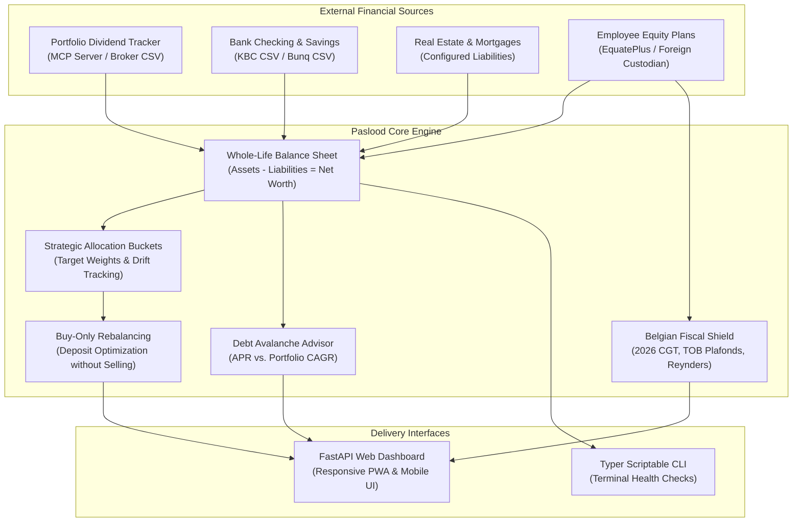
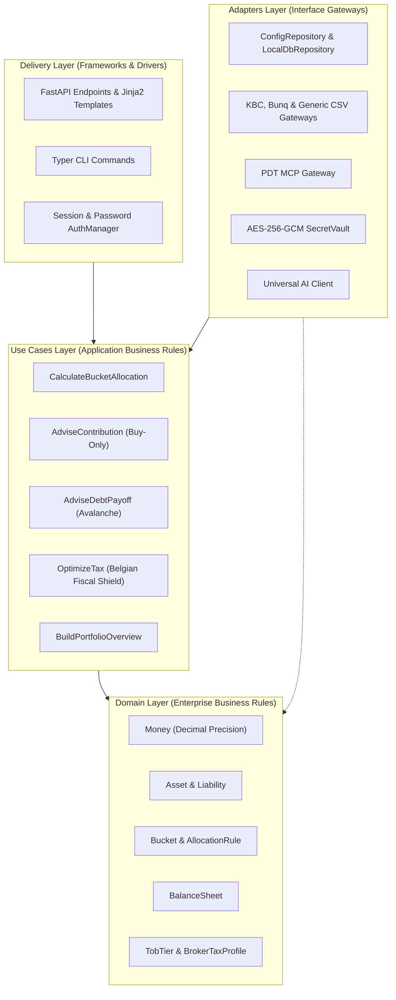

# Paslood 🧭

> **Whole-Life Balance Sheet, Portfolio Allocation Engine & Belgian Fiscal Shield**
>
> Open-source, local-first personal balance sheet management and macro asset allocation platform.

**Paslood** (*in het lood staan* — plumb-line balance) reconciles brokerage portfolios with off-broker liquid cash (KBC, Bunq), pillar pension savings (*pensioensparen*), primary residence equity, amortized loans (mortgages, consumer credit), and recurring employee share purchase plans (e.g., ESPP/equity plans on EquatePlus or foreign custodians).

The engine analyzes your whole-life balance sheet to determine optimal financial allocation: maintaining macro asset allocation targets, prioritizing debt payoff against expected investment returns, and modeling equity sales under Belgian tax legislation.

---

## Architecture Overview



---

## Key Features

- **Whole-Life Balance Sheet**: Combines PDT MCP brokerage holdings (Saxo, manual stocks) with KBC/Bunq bank accounts, pension savings, real estate, mortgages, and consumer loans.
- **Strategic Allocation Buckets**: Define macro pillars (Core ETFs, Single-Stock / Employee Shares, Gold & Commodities, Emergency Buffer, Real Estate) with drift tolerances and optional rebalancing exclusion flags.
- **Buy-Only Rebalancing**: Direct incoming savings deposits to underweight buckets to minimize tracking error without selling assets or triggering capital gains taxes.
- **Legally Grounded Belgian Fiscal Shield**:
  - **2026 Meerwaardebelasting (WIB 92 Art. 90/101)**: FIFO lot tracking with `max(Dec 31 2025 Fotomoment, Historical Purchase Price)` loss protection, 5-year exemption carryover (`€10,000` to `€15,000`, doubled for joint filing), and a 1-click **Max Tax-Free Share Trim Solver**.
  - **EquatePlus (Zurich) vs. Belgian Broker Reconciliation**: Reconciles Equatex AG Zurich settlement statements (`0.35%` commission + `0.15%` Swiss stamp duty, historical FMV gain vs. 31 Dec 2025 fotomoment) and flags unwithheld **Belgian TOB (`0.35%`)** requiring bi-monthly MyMinfin self-declaration.
  - **TOB & Reynders Tax (WDRT Art. 120 & WIB 92 Art. 19bis)**: Full support for `0.12%` / `0.35%` / `1.32%` TOB statutory caps and the `30%` Reynders tax on fixed-income/mixed funds (`>10%` debt claims).
- **Consolidated Balance Sheet & Debt Avalanche**: Unified priority queue comparing debt APRs against expected portfolio CAGR (7.0%) alongside active drift alerts.
- **Server-Side AI Advisor**: Pluggable private advisors (Gemini, Claude, GPT-4o, Ollama) with disk envelope encryption; zero client-side credential exposure.
- **Privacy & Security First**:
  - Local SQLite with WAL mode + AES-256-GCM envelope encryption (`SecretVault`).
  - Network bind guard preventing unauthenticated public exposure.
  - Single-owner private self-hosting; multi-user and SaaS modes are not supported.
- **Flexible Delivery**:
  - **Web Dashboard**: Responsive dark-mode dashboard (with mobile bottom navigation & PWA support).
  - **Scriptable CLI**: Direct terminal reporting (`status`, `advise`, `ingest`, `set-password`).
  - **Docker & Remote Access**: Run standalone or containerized with **Tailscale**, **Cloudflare Tunnel**, or **DuckDNS + Caddy**.

---

## Quick Start Options

### Option A: Local Run via `uv` (Fastest for Local Desktop)

Requires Python 3.12+ (3.14 recommended) and [`uv`](https://docs.astral.sh/uv/).

```bash
# Clone the repository
git clone https://github.com/tiwu/paslood.git
cd paslood

# Install all dependencies
uv sync --all-extras --dev

# Run the Web Dashboard on http://localhost:8000
uv run paslood web

# Run CLI Status Report
uv run paslood status
```

---

### Option B: Containerized via Docker Compose (Recommended for Home Servers & Remote Access)

Requires Docker Engine $\ge 24.0$ & Docker Compose $\ge 2.20$.

```bash
# 1. Clone repository
git clone https://github.com/tiwu/paslood.git
cd paslood

# 2. Copy environment template and generate secret key
cp .env.example .env
openssl rand -hex 32  # Copy output to PASLOOD_SECRET_KEY in .env

# 3. Set master admin password
docker compose run --rm paslood set-password

# 4. Start Paslood
docker compose up -d
```

Open [http://localhost:8000](http://localhost:8000) and log in.

---

## Remote Access: Mobile Phone & Anywhere Access

Paslood supports three zero-trust and self-hosted remote access setups out of the box:

| Method | Profile | Best For | Port Forwarding Needed? |
| :--- | :--- | :--- | :--- |
| **Tailscale** *(Recommended)* | `--profile tailscale` | Private encrypted WireGuard mesh on phone/laptop | **No** (Most secure) |
| **Cloudflare Tunnel** | `--profile cloudflared` | Browser access via custom domain without VPN app | **No** |
| **DuckDNS + Caddy** | `--profile ddns` | Automatic Let's Encrypt TLS reverse proxy | Yes (Ports 80/443) |

#### Running with Tailscale:
```bash
# Set TAILSCALE_AUTHKEY in .env
docker compose --profile tailscale up -d
```
Access securely from your phone or laptop at `http://paslood:8000`.

See the complete [Self-Hosting & Remote Access Guide](docs/self-hosting.md) for full configuration steps.

---

## Authentication & Security

Paslood includes a secure, built-in identity and session manager:

1. **Master Passphrase Authentication**:
   ```bash
   uv run paslood set-password
   ```
2. **Social OAuth 2.0**:
   Configure a provider and exactly one `PASLOOD_ALLOWED_EMAILS` owner address to enable social login. Multiple OAuth identities are rejected because storage is single-owner.
3. **Single-Owner Storage**:
   Password and OAuth access share one portfolio. SaaS mode is deliberately rejected until tenant-scoped persistence is implemented.
4. **Envelope Encryption**:
   Sensitive API keys and external credentials stored in `portfolio.yaml` are encrypted at rest with AES-256-GCM using per-tenant keys derived via HKDF-SHA256.

---

## CLI Reference

```bash
# Show balance sheet, net worth, and allocation drift
uv run paslood status

# Calculate optimal buy-only distribution for a €2,000 deposit
uv run paslood advise --deposit 2000.0

# Set or update master remote access password
uv run paslood set-password

# Ingest bank statements or broker CSVs
uv run paslood ingest statement.csv

# Generate a sample portfolio import template
uv run paslood template --output template.csv

# Launch Web Dashboard (bind guard prevents unauthenticated 0.0.0.0 exposure)
uv run paslood web --port 8000
```

---

## Clean Architecture Overview

Paslood strictly adheres to Clean Architecture (Hexagonal / Ports & Adapters):



---

## Testing & Quality Assurance

```bash
# Run all unit, delivery, and integration tests (250+ tests)
uv run pytest

# Run tests with coverage (target >= 90%)
uv run pytest --cov=src/paslood --cov-report=term-missing

# Lint & code format checks
uv run ruff check src tests scripts
uv run ruff format --check src tests scripts

# Strict documentation build
uv run mkdocs build --strict
```

---

## License

MIT License.
