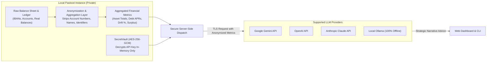

# AI Financial Advisor Setup

Paslood features a server-side AI advisory layer that provides qualitative assessments of macro financial plans.

---

## Privacy-Preserving Architecture



---

## Supported Providers

| Provider | Supported Models | Key Management | Privacy Scope |
| :--- | :--- | :--- | :--- |
| **Google Gemini** *(Recommended)* | `gemini-2.0-flash`, `gemini-1.5-pro` | Encrypted in `SecretVault` | Anonymized metrics payload only |
| **Anthropic Claude** | `claude-3-5-sonnet`, `claude-3-5-haiku` | Encrypted in `SecretVault` | Anonymized metrics payload only |
| **OpenAI** | `gpt-4o`, `gpt-4o-mini` | Encrypted in `SecretVault` | Anonymized metrics payload only |
| **Local Ollama** | Any local model (e.g. `llama3`, `mistral`) | No API key required | **100% offline local inference** |

---

## Configuration

API keys can be supplied via environment variables or entered directly into the Web Dashboard under **Settings $\rightarrow$ AI Advisor**:

```bash
# Optional environment variables
export GEMINI_API_KEY="your-gemini-key"
export ANTHROPIC_API_KEY="your-anthropic-key"
export OPENAI_API_KEY="your-openai-key"
export OLLAMA_HOST="http://localhost:11434"
```

All credentials entered through the UI are encrypted at rest with AES-256-GCM using per-tenant keys derived via HKDF-SHA256.
