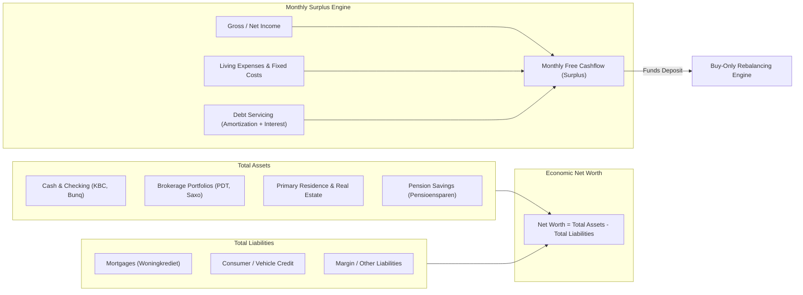

# Balance Sheet & Net Worth Overview

Paslood models personal wealth using classical double-entry balance sheet principles:

$$\text{Net Worth} = \text{Total Assets} - \text{Total Liabilities}$$

---

## Personal Balance Sheet Flow

---

## Balance Sheet Categories

### 1. Assets Ledger

| Asset Class | Source Gateway | Valuation Method | Inclusion Rules |
| :--- | :--- | :--- | :--- |
| **Liquid Cash** | `KbcCsvGateway`, `BunqCsvGateway` | Latest running account balance (`Saldo`) | Liquid Net Worth |
| **Brokerage Securities** | `PdtMcpGateway`, `GenericCsvGateway` | Live mark-to-market (`shares * price`) | Liquid Net Worth |
| **Pension Savings** | `GenericCsvGateway` (KBC Position Overview) | Fund unit value | Illiquid Net Worth |
| **Real Estate** | `manual_assets` in `portfolio.yaml` | User-defined market appraisal | Toggleable (Liquid vs. Total) |

### 2. Liabilities Ledger

| Loan Type | Source Gateway | Amortization Tracking | Strategy Action |
| :--- | :--- | :--- | :--- |
| **Mortgages (`Woningkrediet`)** | `KbcCsvGateway`, `manual_liabilities` | Scheduled monthly principal reduction | Low APR: Maintain minimums |
| **Consumer Credit (`Flex Budget`)** | `KbcCsvGateway`, `manual_liabilities` | Revolving or fixed installment balance | High APR: Avalanche payoff |
| **Vehicle / Installment Loans** | `manual_liabilities` | Linear / amortized monthly schedule | Compare against portfolio CAGR |

---

## 3. Monthly Free Cashflow Formula

$$\text{Monthly Free Cashflow} = \text{Net Income} - (\text{Fixed Expenses} + \text{Debt Servicing} + \text{Discretionary Living})$$

This monthly investable surplus represents the capital capacity deployed into the **Buy-Only Rebalancing Engine**.
