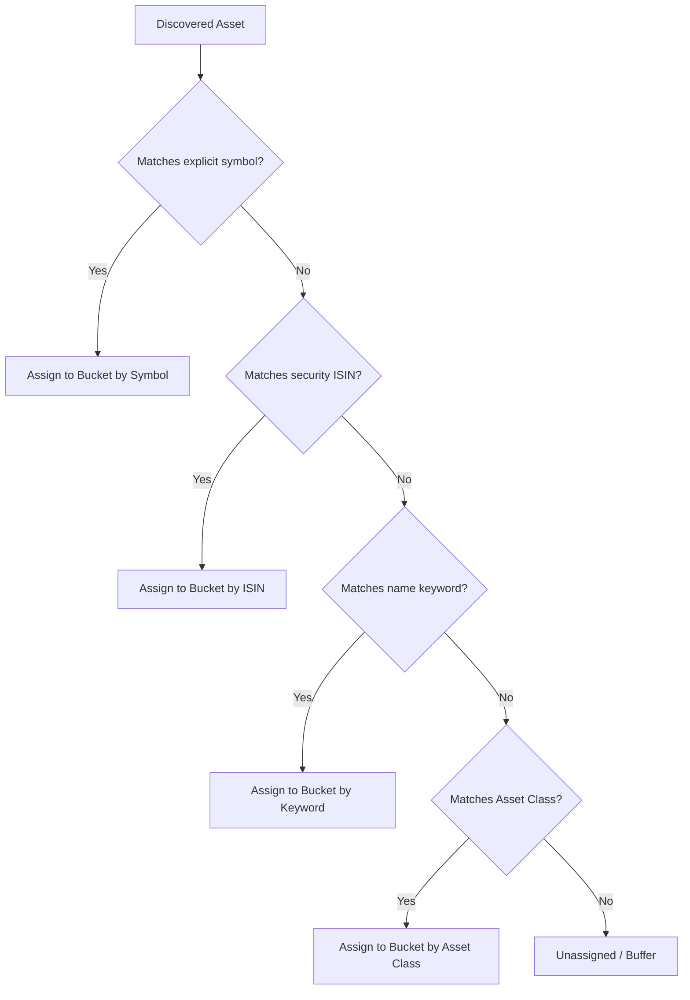

# Strategic Allocation Buckets

Paslood organizes all financial assets into macro **Strategic Allocation Buckets** representing top-level investment pillars.

---

## Rule-Based Asset Matching

Incoming assets are automatically assigned to buckets using a prioritized rule engine:



### Rule Priority Hierarchy

| Priority | Criteria | Example Match Rule | Description |
| :--- | :--- | :--- | :--- |
| **1 (Highest)** | `symbols` | `["VWCE", "IWDA"]` | Explicit ticker symbol match. Takes precedence over generic rules. |
| **2** | `isins` | `["IE00B4L5Y983", "IE00BK5BQT80"]` | Exact 12-character international securities identifier. |
| **3** | `name_keywords` | `["World", "Treasury", "Gold"]` | Substring match against asset display names. |
| **4 (Lowest)** | `asset_classes` | `["EQUITY", "ETF", "CASH"]` | Fallback classification based on instrument type. |

---

## Target Weights & Drift Statuses

Each bucket defines a **Target Weight (%)** and a **Drift Tolerance ($\pm\%$)** (default: $\pm 3.0\%$).

| Drift Status | Condition | Indicator | Engine Action |
| :--- | :--- | :--- | :--- |
| **BALANCED** | $\vert \text{Actual \%} - \text{Target \%} \vert \le \text{Tolerance}$ | 🟢 Balanced | Target weight satisfied. No mandatory action. |
| **UNDERWEIGHT** | $\text{Actual \%} < \text{Target \%} - \text{Tolerance}$ | 🔵 Underweight | Deficit identified. Buy-Only calculator routes deposits here. |
| **OVERWEIGHT** | $\text{Actual \%} > \text{Target \%} + \text{Tolerance}$ | 🟡 Overweight | Surpasses target. Further capital allocation is paused. |

---

## Sample Bucket Configuration (`portfolio.yaml`)

```yaml
buckets:
  - id: "core-etf"
    name: "Core World ETFs"
    target_weight: 50.0
    drift_tolerance: 3.0
    symbols: ["VWCE", "IWDA"]
    asset_classes: ["ETF"]

  - id: "tech-growth"
    name: "High-Conviction Equities"
    target_weight: 35.0
    drift_tolerance: 5.0
    asset_classes: ["EQUITY"]

  - id: "commodities"
    name: "Gold & Commodities"
    target_weight: 5.0
    drift_tolerance: 2.0
    symbols: ["4GLD", "SGLD"]

  - id: "cash-buffer"
    name: "Liquid Cash Buffer"
    target_weight: 10.0
    drift_tolerance: 2.0
    asset_classes: ["CASH"]
```
