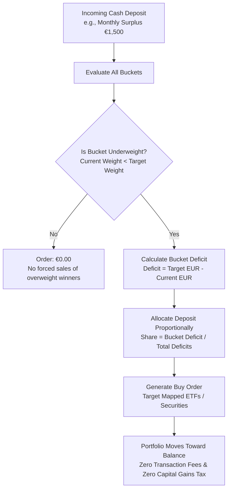

# Buy-Only Rebalancing Strategy

Traditional portfolio rebalancing sells over-allocated assets to purchase under-allocated assets. In private investing, selling triggers friction:
1. **Transaction Fees**: Broker commissions on both legs of the trade.
2. **Exchange Taxes**: Belgian Stock Exchange Tax (TOB) levied on both sale and purchase transactions.
3. **Capital Gains Taxes**: Realizing taxable profits prematurely.

---

## Buy-Only Rebalancing Flow



---

## Rebalancing Strategy Comparison

| Metric | Traditional Selling Rebalance | Paslood Buy-Only Rebalance |
| :--- | :--- | :--- |
| **Tax Impact** | Triggers capital gains tax & double TOB | **Zero capital gains tax, single TOB** |
| **Broker Commissions** | Paid on sells and buys | **Paid on buys only** |
| **Portfolio Churn** | High turnover | **Zero turnover; pure accumulation** |
| **Execution Timeframe** | Instantaneous | Gradual convergence with monthly cashflow |

---

## Calculation Example

```text
Deposit Capacity: € 2,000.00

Shortfall Evaluation:
- Core World ETFs:     Current € 45,000 | Target € 60,000 | Shortfall € 15,000 (60%)
- High-Conviction Tech: Current € 25,000 | Target € 35,000 | Shortfall € 10,000 (40%)
- Gold & Commodities:   Current €  5,000 | Target €  5,000 | Shortfall €      0 ( 0%)

Optimal Buy Allocation:
1. BUY € 1,200.00 in Core World ETFs (60% of deposit)
2. BUY €   800.00 in High-Conviction Tech (40% of deposit)
3. BUY €     0.00 in Gold & Commodities
```
