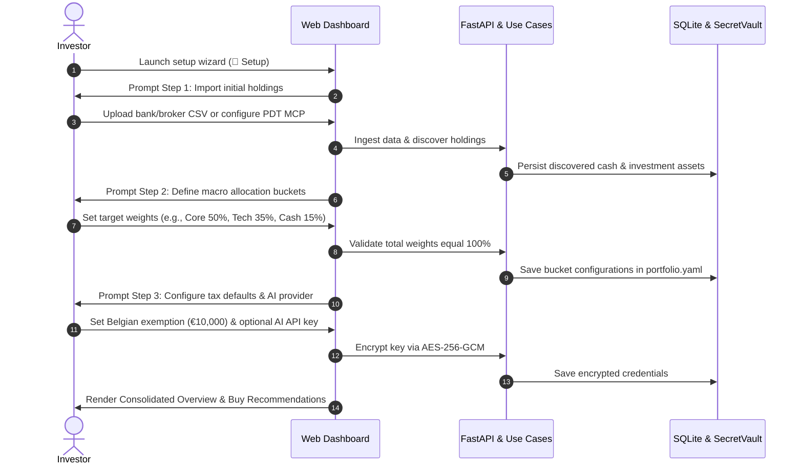

# Getting Started with Paslood

This guide details setting up Paslood for local desktop use or on a private home server.

---

## 1. Quickstart

### Option A: Local Run via `uv`

#### Prerequisites
- **Python 3.12+** (3.14 recommended)
- [`uv`](https://docs.astral.sh/uv/) package manager

#### Setup
```bash
# 1. Clone repository
git clone https://github.com/tiwu/paslood.git
cd paslood

# 2. Install dependencies
uv sync --all-extras --dev

# 3. Launch the Web Dashboard
uv run paslood web
```

Open [http://127.0.0.1:8000](http://127.0.0.1:8000).

---

### Option B: Docker Compose

#### Prerequisites
- **Docker Engine $\ge 24.0$** & **Docker Compose $\ge 2.20$**

#### Setup
```bash
# 1. Clone repository
git clone https://github.com/tiwu/paslood.git
cd paslood

# 2. Configure environment
cp .env.example .env
openssl rand -hex 32  # Paste into PASLOOD_SECRET_KEY in .env

# 3. Set master administrator password
docker compose run --rm paslood set-password

# 4. Start container
docker compose up -d
```

Open [http://localhost:8000](http://localhost:8000) and sign in.

---

## 2. Onboarding Workflow



---

## 3. Storage Architecture & Privacy

All application state is stored locally within the configured data directory:
- **Local default**: `~/.paslood/`
- **Docker default**: `/data` (container volume)
- **Environment override**: `PASLOOD_DATA_DIR`

| File | Purpose | Security / Encryption |
| :--- | :--- | :--- |
| `portfolio.yaml` | Strategic bucket definitions, manual assets, and liabilities. | Non-secret config |
| `rules.yaml` | Custom transaction categorization rules. | Non-secret config |
| `paslood.db` | SQLite database storing transaction history, cashflow summaries, and discovered assets. | Local file (WAL mode) |
| `auth.db` | Authentication database storing salted user credentials and session tokens. | Argon2id / HMAC tokens |
| `.secret_key` | Master 32-byte encryption key. | AES-256-GCM envelope root |

---

## 4. Scriptable CLI Reference

```bash
# Inspect balance sheet, net worth, and allocation drift
uv run paslood status

# Calculate buy-only deposit allocation for a €1,500 contribution
uv run paslood advise --deposit 1500.0

# Set or update master remote access password
uv run paslood set-password

# Parse and inspect a statement CSV
uv run paslood ingest path/to/statement.csv

# Generate a sample generic CSV template
uv run paslood template --output template.csv
```
