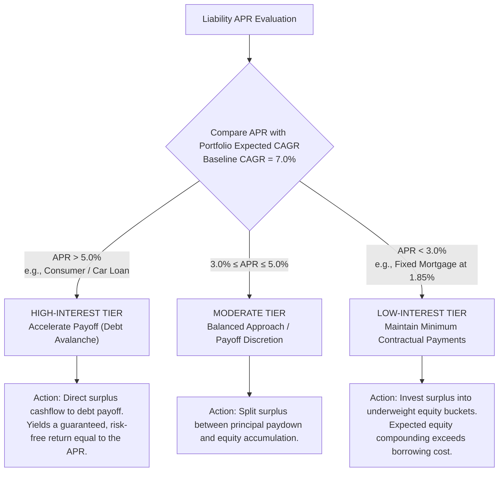

# Debt Payoff Strategy: Avalanche vs. Investing

Wealth builders with surplus cashflow face a structural decision:  
**Should monthly savings accelerate loan payoff or be invested in the equity portfolio?**

Paslood evaluates this trade-off using a mathematical hurdle rate framework.

---

## Hurdle Rate Decision Framework

---

## Debt Decision Matrix

| Interest Tier | APR Range | Priority | Rationale & Recommended Action |
| :--- | :--- | :--- | :--- |
| **High Interest** | **$> 5.0\%$** | **Priority 1 (Urgent)** | Debt payoff provides a guaranteed, tax-free return equal to the loan APR. Direct 100% of investable cashflow to extinguish this balance first. |
| **Moderate Interest** | **$3.0\% - 5.0\%$** | **Priority 2 (Discretionary)** | Near the hurdle boundary. Split surplus 50/50 between principal reduction and underweight bucket accumulation. |
| **Low Interest** | **$< 3.0\%$** | **Priority 3 (Maintain Minimums)** | Borrowing cost is substantially below long-term expected equity returns (7.0%). Pay contractual monthly minimums and invest remaining surplus. |
