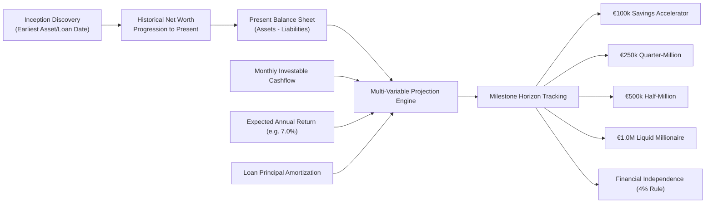

# Net Worth Milestone Projections

Paslood models long-term compound wealth trajectories over 5, 10, 20, and 30-year horizons using multi-variable simulations.

---

## Trajectory Simulation Pipeline

---

## Core Simulation Variables

1. **Current Net Worth**: Starting balance sheet equity ($\text{Assets} - \text{Liabilities}$).
2. **Monthly Savings Rate**: Net investable cashflow surplus derived from bank statements and income.
3. **Compound Annual Growth Rate (CAGR)**: Long-term gross investment return assumption (baseline: 7.0%).
4. **Debt Amortization Schedule**: Monthly principal reduction across active mortgages and installment loans.

---

## Standard Milestone Definitions

| Milestone | Target Valuation | Economic Significance |
| :--- | :--- | :--- |
| **Baseline Accelerator** | **€ 100,000** | Threshold where investment compounding begins matching or exceeding annual savings contributions. |
| **Quarter-Million** | **€ 250,000** | Mid-stage accumulation milestone. |
| **Half-Million** | **€ 500,000** | Substantial capital base providing significant investment yield. |
| **Liquid Millionaire** | **€ 1,000,000** | Liquid independence threshold. |
| **Financial Independence (FI)** | **$25 \times \text{Annual Expenses}$** | Crossover point where a 4.0% safe withdrawal rate covers all annual living costs. |
