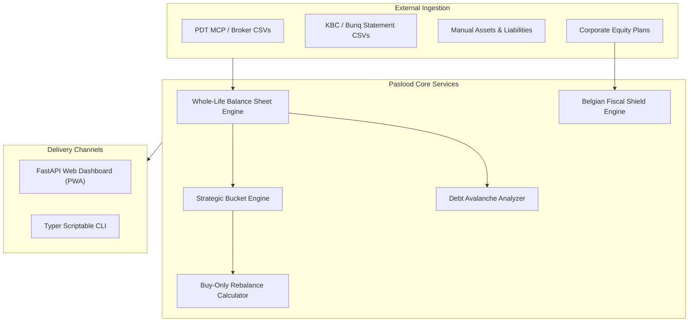

# Paslood Documentation 🧭

> **Whole-Life Balance Sheet, Portfolio Allocation Engine & Belgian Fiscal Shield**

Paslood (*in het lood staan* — plumb-line alignment) is an open-source, local-first platform designed to unify brokerage portfolios with off-broker assets, debts, and fiscal obligations.

---

## System Overview

---

## Core Capabilities

| Capability | Technical Scope | Primary Statutory / Domain Model |
| :--- | :--- | :--- |
| **Whole-Life Balance Sheet** | Aggregates liquid cash, brokerage securities, pension schemes, real estate, mortgages, and amortized consumer loans into a single net worth ledger. | `BalanceSheet = Assets - Liabilities` |
| **Strategic Allocation Buckets** | Defines target percentage weights for macro pillars with configurable drift boundaries (default: $\pm 3.0\%$). | `CalculateBucketAllocationUseCase` |
| **Buy-Only Rebalancing** | Directs periodic savings deposits to underweight buckets, restoring target weights without selling assets or realizing capital gains. | `AdviseContributionUseCase` |
| **2026 Meerwaardebelasting** | Models the 10% Belgian capital gains tax on financial assets, incorporating the 31 Dec 2025 fotomoment cost basis, historical loss protection, and 5-year exemption carryover. | `WIB 92 Art. 90, 1° & Art. 101–102` |
| **EquatePlus Reconciliation** | Distinguishes Swiss brokerage fees (`0.35%`) and Swiss stamp duty (`0.15%`) from unwithheld Belgian stock exchange tax (`0.35% TOB`). | `WDRT Art. 120–126/2` |
| **Reynders Fund Tax** | Calculates the 30% withholding tax on the fixed-income portion of accumulating/distributing funds with $>10\%$ debt claims. | `WIB 92 Art. 19bis` |
| **Debt Payoff Optimization** | Evaluates loan APRs against expected long-term portfolio CAGR (baseline: 7.0%) to prioritize debt avalanche vs. investing. | `AdviseDebtPayoffUseCase` |
| **Local-First Privacy** | Enforces single-owner data isolation, local SQLite persistence with WAL mode, and AES-256-GCM envelope encryption. | `SecretVault` / `AppSettings` |

---

## Architectural Principles

Paslood enforces Clean Architecture layer boundaries:

1. **`domain/`**: Enterprise business rules (`Money`, `Asset`, `Liability`, `Bucket`, `AllocationRule`, `BalanceSheet`, `TobTier`, `BrokerTaxProfile`). Zero external dependencies.
2. **`use_cases/`**: Application workflows (`CalculateBucketAllocation`, `AdviseContribution`, `AdviseDebtPayoff`, `ProjectNetWorth`, `CategorizeTransactions`, `OptimizeTax`, `BuildPortfolioOverview`).
3. **`adapters/`**: Gateways and infrastructure (`KbcCsvGateway`, `BunqCsvGateway`, `GenericCsvGateway`, `PdtMcpGateway`, `ConfigRepository`, `LocalDbRepository`, `SecretVault`).
4. **`delivery/`**: User interfaces (`delivery/web` FastAPI application, responsive dark-mode PWA, `cli.py` Typer CLI).
