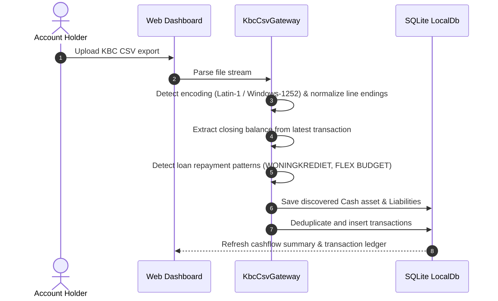

# Ingesting Belgian KBC Bank Statements

Paslood provides native parsing for **KBC Bank CSV statement exports**.

---

## Ingestion Flow

---

## Supported Statement Formats

| Statement Type | Header Signatures | Encoding | Auto-Discovered Data |
| :--- | :--- | :--- | :--- |
| **Checking (`Zichtrekening`)** | `Rekeningnummer;Datum;Bedrag;Omschrijving` | ISO-8859-1 | Current liquid cash, salary income, mortgage payments (`WONINGKREDIET`), revolving credit (`FLEX BUDGET`). |
| **Savings (`Spaarrekening`)** | `Rekeningnummer;Datum;Bedrag;Omschrijving` | ISO-8859-1 | Dedicated emergency savings cash asset, transfer inflows/outflows. |
| **Credit Card** | `kredietkaart;kaarthouder;bedrag in EUR` | Windows-1252 | Credit card transactions, merchant locations, foreign currency conversions. |
| **Position Overview** | `Productklasse;Waardeinfo/ISIN;Naam product` | ISO-8859-1 | Pension savings funds (*Pensioensparen*), mutual funds, investment cash accounts. |

---

## Automated Field Parsing Specs

- **Delimiters**: Semicolon (`;`) delimiter with European number formatting (`1.250,50` $\rightarrow$ `Decimal("1250.50")`).
- **Date Format**: `DD/MM/YYYY`.
- **Deduplication**: SHA-256 row hashing incorporating row sequence indexes to preserve legitimate same-day charges while ensuring idempotent re-uploads.
