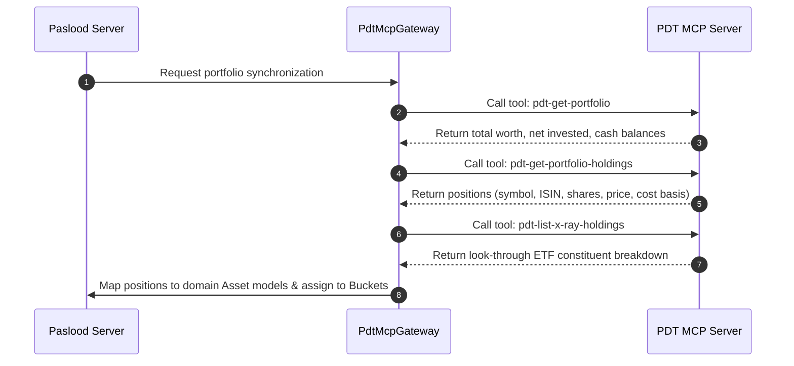

# PDT MCP Server Integration

Paslood connects to the **Portfolio Dividend Tracker (PDT)** Model Context Protocol (MCP) server over JSON-RPC to synchronize broker holdings.

---

## Integration Protocol



---

## MCP Tools Reference

| PDT Tool | Purpose | Domain Mapping |
| :--- | :--- | :--- |
| `pdt-get-portfolio` | Fetches high-level portfolio metrics | Liquid investment total, cash balances |
| `pdt-get-portfolio-holdings` | Returns active securities and lots | Domain `Asset` (shares, current value, cost basis) |
| `pdt-list-x-ray-holdings` | Inspects ETF underlying holdings | Look-through sector and regional exposure |

---

## Configuration (`portfolio.yaml`)

```yaml
pdt_mcp:
  url: "http://localhost:3000/mcp"
  auth_token: "your-pdt-auth-token"
```
