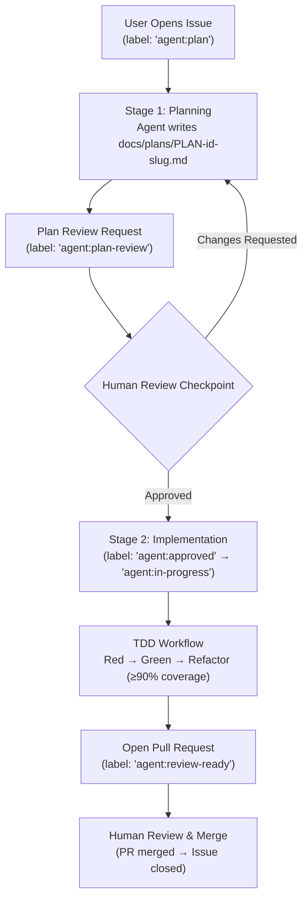

# Architecture & Feature Plans

This directory contains version-controlled architectural specifications and implementation plans for **Paslood**.

---

## Two-Stage Issue & Plan Lifecycle



---

## Naming Standards

Plan files follow the naming convention:
```text
docs/plans/PLAN-<issue_number>-<slug>.md
```

Examples:
- `docs/plans/PLAN-3-option-to-exclude-bucket-from-weight-cal.md`
- `docs/plans/PLAN-30-security-precision-vault.md`

Every non-trivial architectural change must adhere to [`PLAN-TEMPLATE.md`](PLAN-TEMPLATE.md) and specify Clean Architecture layer boundaries, TDD verification strategies, and statutory citations where applicable.
