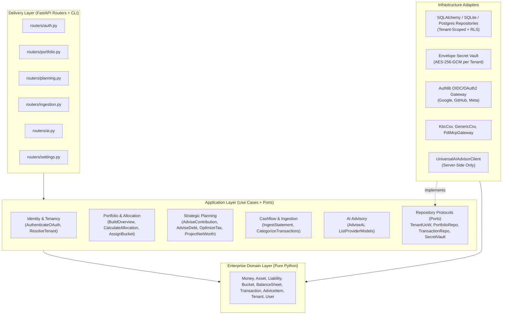

# Paslood — Software Architecture & SaaS/IaaS Readiness Review

> Historical assessment dated 2026-10-25. The application currently enforces a single-owner storage model and rejects SaaS mode; SaaS and multi-user recommendations below are not current product capabilities.

- **Date**: 2026-10-25
- **Lenses Applied**: Clean Architecture (`.agents/skills/clean-architecture`), Kent Beck Simple Design (`.agents/skills/kent-beck-style`), Domain-Driven Design (`.agents/skills/domain-driven-design`), Designing Data-Intensive Applications (`.agents/skills/ddia-systems`)
- **Strategic Target**: Dual-mode deployment — **Self-Hosted Container / IaaS** (Docker + Tailscale/Cloudflare/DDNS) and **Multi-Tenant SaaS** with OAuth/OIDC Social Login (Google, GitHub, Meta), server-side AI, and strict tenant isolation.

---

## 1. Executive Summary (Top 5 Findings)

1. **[CRITICAL] Zero Authentication & Arbitrary Server-File Write (`app.py`)**: All 35+ REST endpoints had no authentication. Worse, `POST /api/backup/cloud-sync` (`src/paslood/delivery/web/app.py:1296-1350`) accepted an arbitrary `sync_dir` string from the JSON body and wrote/read `paslood_vault.wpbackup` anywhere on the host filesystem. In a remotely accessible or SaaS environment, this was a critical path-traversal / arbitrary file read-write vulnerability.
2. **[CRITICAL] Process-Global Mutable State & File-Based Single-Tenancy (`app.py`, `config_repo.py`)**: `create_app()` held mutable singleton dicts `pending_oauth` and `state["pdt_assets"]` (`src/paslood/delivery/web/app.py:302-305`) in memory, and `ConfigRepository` performed unguarded read-modify-write cycles on `~/.paslood/portfolio.yaml` (`src/paslood/adapters/repositories/config_repo.py:166`). Concurrent requests or multiple users could overwrite each other's portfolios and leak holdings across sessions.
3. **[HIGH] Fat Delivery Controller & Business Logic Leakage (`app.py`)**: `app.py` was 1,357 lines with 35+ endpoints defined inline inside `create_app()`. Domain rules—balance sheet consolidation (`src/paslood/delivery/web/app.py:307-342`), property exclusion filtering (`src/paslood/delivery/web/app.py:355-363`), drift alert construction (`src/paslood/delivery/web/app.py:380-392`), milestone math (`src/paslood/delivery/web/app.py:474-490`), and loan amortization fallback (`src/paslood/delivery/web/app.py:737-766`)—lived inside HTTP route handlers instead of Use Cases.
4. **[HIGH] Missing Repository Ports & Split-Brain Persistence (`config_repo.py`, `local_db.py`)**: `use_cases/` had zero `Protocol` interfaces for persistence. Manual liabilities were written to both `portfolio.yaml` and SQLite `discovered_liabilities` (`src/paslood/delivery/web/app.py:771-788`), creating dual sources of truth. SQLite stored monetary amounts as IEEE 754 `REAL` floats (`src/paslood/adapters/repositories/local_db.py:49-93`) instead of integer cents or exact numeric strings.
5. **[MEDIUM] SSRF & Secret Exposure Surfaces (`app.py`, `llm_client.py`)**: `POST /api/settings/mcp/servers/test` (`src/paslood/delivery/web/app.py:1114-1165`) blocked link-local IPs (`169.254.169.254`) but allowed `127.0.0.1`, `localhost`, and RFC1918 private networks (`10.0.0.0/8`, `172.16.0.0/12`, `192.168.0.0/16`), enabling SSRF against internal container services (including Ollama or Redis/Postgres).

---

## 2. Detailed Findings Table

| ID | Severity | Area | Location | Problem | Recommended Fix | Status & Resolution |
| :--- | :--- | :--- | :--- | :--- | :--- | :--- |
| **ARCH-01** | Critical | Security / SaaS | app.py | `/api/backup/cloud-sync` takes arbitrary `sync_dir` path from client request and reads/writes files on the server host. | Disable host-filesystem path sync in container/SaaS mode; use browser download/upload (`/api/backup/export` & `import`) or server-configured backup storage volume only. | **Resolved in [#30](https://github.com/tiwu/paslood/issues/30)** (blocked in remote/container mode; local mode sandboxed to user home and data directory) |
| **ARCH-02** | Critical | Security / Auth | app.py | No authentication or authorization on any route. Origin check only checks `Origin` header when present. | Add OAuth2/OIDC authentication middleware + `CurrentTenant` FastAPI dependency injected into every `/api/*` router. | **Resolved in [#11](https://github.com/tiwu/paslood/pull/11)** (`AuthManager`, social OAuth, session cookies, external bind guard; multi-user SaaS rejected by product vision) |
| **ARCH-03** | Critical | Concurrency / State | app.py | `pending_oauth` and `state["pdt_assets"]` are module/app-scoped dicts shared across all requests and users. | Store OAuth PKCE state in signed session cookie or DB table with TTL; persist PDT assets per `tenant_id` in DB (`discovered_assets`). | **Resolved in [#29](https://github.com/tiwu/paslood/issues/29)** (OAuth state persisted in SQLite `oauth_states`; PDT assets cached directly in `discovered_assets`) |
| **ARCH-04** | High | Clean Arch | app.py | `get_overview` (200 lines) orchestrates asset deduplication, property filtering, drift AdviceItem creation, and milestone calculation inside the web layer. | Extract `BuildPortfolioOverviewUseCase` in `use_cases/overview.py` tested purely against domain entities. | **Resolved in [#11](https://github.com/tiwu/paslood/pull/11) & [#29](https://github.com/tiwu/paslood/issues/29)** (`BuildPortfolioOverviewUseCase` extracted in #11; `app.py` modularized into FastAPI APIRouters in #29) |
| **ARCH-05** | High | Clean Arch / DRY | app.py & config_repo.py | Loan amortization & percentage-payment fallback logic is duplicated verbatim between `app.py` (using `float`) and `config_repo.py` (using `Decimal`). | Move into `Liability.create_or_estimate(...)` domain factory method using `Decimal` exclusively. | **Resolved in [#11](https://github.com/tiwu/paslood/pull/11)** (`Liability.calculate_amortized_state`) |
| **ARCH-06** | High | Data / DDIA | config_repo.py, local_db.py | Hardcoded `Path.home() / ".paslood"` and `~/.pdt_auth.json`; no env-var data directory configuration. | Introduce `AppSettings` (`PASLOOD_DATA_DIR`) and migrate YAML state into tenant-scoped relational tables. | **Resolved in [#11](https://github.com/tiwu/paslood/pull/11)** (`AppSettings.from_env()` with `PASLOOD_DATA_DIR`) |
| **ARCH-07** | High | Security / SSRF | app.py | `test_mcp_server` only blocks link-local IPs; permits loopback (`127.0.0.1`), private IPs (`10.x`, `192.168.x`), and DNS rebinding. | Resolve hostname via `socket.getaddrinfo` and block `ip.is_private`, `ip.is_loopback`, `ip.is_link_local`, `ip.is_reserved` in SaaS/remote mode. | **Resolved in [#11](https://github.com/tiwu/paslood/pull/11)** (DNS resolution, global IP check, pinned backend) |
| **ARCH-08** | Medium | Precision | app.py, local_db.py | Request Pydantic models use `float` for money/weights; SQLite schema uses `REAL`. | Use `Decimal` in Pydantic models and `NUMERIC(18,2)` / integer cents or text in SQLite/Postgres. | **Resolved in [#30](https://github.com/tiwu/paslood/issues/30)** (Pydantic models upgraded to Decimal, SQLite NUMERIC precision schema, exact string serialization) |
| **ARCH-09** | Medium | Crypto / Secrets | config_repo.py | Custom home-rolled stream cipher (`PBKDF2` + HMAC-SHA256 CTR-XOR) for vault encryption; AI keys & PDT tokens stored in plaintext in `portfolio.yaml`. | Keep v1 decryptor for backward-compatible restore, but use standard `cryptography.fernet` / `AESGCM` for v2 vault and for per-tenant envelope encryption of stored API keys/tokens. | **Resolved in [#30](https://github.com/tiwu/paslood/issues/30)** (`SecretVault` for keys/tokens in #11; AES-256-GCM v2 backup vault with v1 backward compatibility in #30) |
| **ARCH-10** | Medium | CLI / Drift | cli.py | `paslood status` hardcodes fake cashflow numbers (`4800.0`, `1200.0`, `1553.92`, `800.0`) instead of reading `LocalDbRepository.get_monthly_cashflow()`. | Wire `cli.py` to the same `PortfolioUnitOfWork` / `BuildPortfolioOverviewUseCase` as the web app. | **Resolved in [#11](https://github.com/tiwu/paslood/pull/11)** (`status` calls `BuildPortfolioOverviewUseCase` with real cashflow) |
| **ARCH-11** | Low | CSP / AI | app.py | `connect-src` in CSP whitelists `generativelanguage.googleapis.com`, `api.openai.com`, `api.anthropic.com` even though AI calls are already executed via `/api/ai/advise` and `/api/ai/models`. | Remove external LLM domains from browser `connect-src`; stop accepting raw `api_key` in `GET /api/ai/models` query params which leaks keys in access logs. | **Resolved in [#30](https://github.com/tiwu/paslood/issues/30)** (CSP tightened in #11; `api_key` URL query param removed in #30) |

---

## 3. Clean Architecture & Bounded Context Map (DDD)

### 3.1 Current vs. Target Layering
- **Domain (`src/paslood/domain/`)**: 100% pure Python today (passes the Dependency Rule check—zero framework imports).
- **Use Cases (`src/paslood/use_cases/`)**: Pure today, **but** missing repository ports (`Protocol`) and missing an application-level orchestrator for the consolidated dashboard, forcing `app.py` and `cli.py` to duplicate orchestration logic.
- **Adapters (`src/paslood/adapters/`)**: `ConfigRepository` (814 lines) is a "God Repository" managing 6 distinct aggregates in one YAML file (`buckets`, `manual_assets`, `manual_liabilities`, `milestones`, `settings`, `rules`).
- **Delivery (`src/paslood/delivery/`)**: Monolithic `app.py` (1,357 lines) + `index.html` (3,815 lines).

### 3.2 Six Bounded Contexts

---

## 4. Multi-Tenancy & Data Architecture (DDIA Evaluation)

To support **both** a lightweight single-container self-hosted install (Raspberry Pi / NAS / VPS) **and** a multi-tenant cloud SaaS from a single codebase:

### 4.1 Storage Engine Tradeoff Matrix

| Option | Self-Host Ergonomics | SaaS Multi-Tenant Isolation | Operational Complexity | Verdict |
| :--- | :--- | :--- | :--- | :--- |
| **A. YAML + SQLite (Current)** | Easy, human-editable YAML | Unsafe (race conditions, no locks, split-brain state) | Low locally, impossible in SaaS | **Retire YAML as primary store** (keep YAML import/export for power users) |
| **B. SQLite-per-Tenant (`data/tenants/<tenant_id>.db`)** | Zero external DB container needed; trivial per-user backup | Physical file isolation per tenant; zero cross-tenant query risk | Medium at >5,000 concurrent SaaS tenants | **Best for Self-Host & Early SaaS** |
| **C. Shared PostgreSQL + `tenant_id` + Row-Level Security (RLS)** | Requires Postgres container | Industry-standard SaaS isolation (`SET app.current_tenant_id`); horizontal scaling | Standard cloud DB ops + Alembic migrations | **Best for Scale SaaS** |

### 4.2 Recommended Unified Persistence Strategy
1. **Unify YAML + SQLite into a single Relational Schema** managed via **SQLAlchemy 2.0 (Core/ORM) + Alembic**:
   - Tables: `users`, `oauth_identities`, `tenants`, `tenant_memberships`, `buckets`, `bucket_rules`, `assets`, `liabilities`, `transactions`, `transaction_rules`, `milestones`, `tenant_settings`, `encrypted_secrets`.
   - Every domain table includes `tenant_id TEXT NOT NULL` indexed as `(tenant_id, id)`.
2. **Dual-Dialect Support (`DATABASE_URL`)**:
   - **Self-Hosted Default**: `sqlite:////data/paslood.db` (with `PRAGMA journal_mode=WAL; PRAGMA foreign_keys=ON;`). Zero extra containers required.
   - **SaaS Production**: `postgresql+psycopg://...` with PostgreSQL **Row-Level Security (RLS)** policies (`USING (tenant_id = current_setting('app.current_tenant_id'))`) as defense-in-depth so even a buggy query cannot read another tenant's rows.
3. **Automatic One-Time Migration from Legacy `~/.paslood/portfolio.yaml`**:
   - On startup, if `portfolio.yaml` exists and the default tenant has not been migrated, import buckets, manual assets/liabilities, milestones, rules, and settings into the DB and rename `portfolio.yaml` to `portfolio.yaml.migrated.bak`.
4. **Per-Tenant Envelope Encryption for Secrets (`SecretVault`)**:
   - AI API keys (`gemini`, `openai`, `anthropic`) and PDT OAuth tokens (`access_token`, `refresh_token`) are never stored in plaintext.
   - Derived per-tenant Data Encryption Key (DEK) via `HKDF-SHA256(master_key=PASLOOD_SECRET_KEY, salt=tenant_id)` encrypts each secret with `AES-256-GCM`.
   - Keys never leave the server: `GET /api/ai/models` uses the stored server-side key for the authenticated tenant; `POST /api/ai/advise` executes strictly server-side.

---

## 5. Identity, OAuth2/OIDC Social Login & Deployment Modes

### 5.1 Provider Architecture (`Authlib`)
Use `authlib` + `itsdangerous` (Starlette `SessionMiddleware` + DB-backed session store) with a unified `/auth/{provider}/login` and `/auth/{provider}/callback` flow:

| Provider | Protocol | Scopes | Production Caveats |
| :--- | :--- | :--- | :--- |
| **Google** | OIDC (`accounts.google.com/.well-known/openid-configuration`) | `openid email profile` | Seamless setup; returns verified email + `sub`. |
| **GitHub** | OAuth2 (`github.com/login/oauth/authorize` + `/user` + `/user/emails`) | `read:user user:email` | Fetch primary verified email from `/user/emails` endpoint in case profile email is private. |
| **Meta (Facebook)** | OAuth2 (`facebook.com/v19.0/dialog/oauth` + Graph `/me?fields=id,name,email`) | `public_profile,email` | Requires Meta Business Verification & App Review + Privacy Policy/Data Deletion Callback URLs before live non-developer logins work. Make optional via env vars. |
| **Local Passphrase / Magic Link (Fallback)** | Argon2id password or Admin Bootstrap Token | Local session | Ensures self-hosters can log in on day 1 before configuring OAuth client IDs. |

### 5.2 Account Linking & Tenant Resolution
- **Data Model**:
  - `User (id, primary_email, display_name, avatar_url, created_at)`
  - `OAuthIdentity (provider, provider_subject_id, user_id, email)` — unique on `(provider, provider_subject_id)`.
  - `Tenant (id, name, plan, created_at)`
  - `TenantMembership (tenant_id, user_id, role: OWNER | MEMBER | VIEWER)` — supports future household sharing!
- **Sign-In Flow**:
  1. Callback verifies `state` + PKCE `code_verifier`.
  2. Look up `OAuthIdentity(provider, sub)`.
  3. If not found and email is verified by the IdP, link to existing `User` with matching `primary_email` (or create new `User` + personal `Tenant` with default buckets).
  4. **Self-Host Guard**: If `PASLOOD_ALLOWED_EMAILS` is set (e.g. `you@gmail.com,partner@gmail.com`), reject any login not in the allow-list with `403 Forbidden`.

---

## 6. Poller (`scripts/poll_issues.py`) vs. GitHub Action Evaluation

### Findings
- `.github/workflows/issue-worker.yml` **actually invokes** `scripts/poll_issues.py` on line 68 (`uv run python scripts/poll_issues.py "${ARGS[@]}"`). They are not two independent implementations—`poll_issues.py` is the CLI script used by the GitHub Action!
- **Why it is "half-working"**:
  1. **Stage 1 (`process_planning_stage`, `scripts/poll_issues.py:143-203`)**: Writes a static boilerplate template (`draft_plan_content`) that merely copies `issue.body` into `docs/plans/PLAN-<id>-<slug>.md` without any actual codebase analysis or AI planning. Worse, when triggered in GitHub Actions, it commits and pushes to `feature/issue-<id>-<slug>`, which leaves the local workspace on a dirty branch when run locally.
  2. **Stage 2 (`process_approved_stage`, `scripts/poll_issues.py:312-330`)**: Only changes the GitHub label from `agent:approved` to `agent:in-progress` and posts a comment saying *"Implementation is beginning..."* — **it does not actually invoke an agent, create the branch in CI, or run any code!**

### Recommendation
- **Keep `scripts/poll_issues.py` as a lightweight CLI helper (`paslood-dev queue`) solely for local developer/agent inspection (`--status`, `--start-issue <id>`)**, and **simplify `.github/workflows/issue-worker.yml`**:
  1. Remove the hourly `cron: "0 * * * *"` schedule from `issue-worker.yml` (it wastes GitHub Actions minutes every hour since `issues: types: [opened, labeled]` already triggers immediately on label change).
  2. Fix `poll_issues.py` so Stage 2 (`--checkout <issue>`) cleanly fetches `origin/main` and checks out `feature/issue-<id>-<slug>` locally for the developer/agent, rather than pretending to run autonomous implementation inside an unauthenticated Ubuntu runner with no LLM key.

---

## 7. Phased Architecture Roadmap

| Phase | ID | Item (Suggested GitHub Issue Title) | Size |
| :--- | :--- | :--- | :--- |
| **Phase 1: Foundation & Self-Host Container** | `P1-1` | `refactor(arch): extract APIRouters and BuildPortfolioOverviewUseCase from fat app.py` | M |
| | `P1-2` | `feat(config): add AppSettings with PASLOOD_DATA_DIR and disable arbitrary host path sync` | S |
| | `P1-3` | `feat(ai): enforce server-side AI key usage, tighten CSP, and harden MCP test SSRF check` | S |
| | `P1-4` | `feat(docker): add production Dockerfile, docker-compose (Tailscale/Cloudflare/Caddy), and /healthz` | M |
| **Phase 2: Social Auth & Account Isolation** | `P2-1` | `feat(auth): add OAuth2/OIDC login (Google, GitHub, Meta) + local password fallback & email allow-list` | M |
| | `P2-2` | `feat(db): unify YAML + SQLite into tenant-scoped relational schema with automatic YAML migration` | L |
| | `P2-3` | `feat(security): encrypt per-tenant AI keys and PDT tokens at rest with AES-256-GCM SecretVault` | M |
| **Phase 3: Multi-Tenant SaaS Readiness** | `P3-1` | `feat(saas): add PostgreSQL + Row-Level Security (RLS) adapter and Alembic migrations` | M |
| | `P3-2` | `feat(saas): household multi-user tenant memberships, audit logging, and GDPR account export/delete` | M |
| | `P3-3` | `chore(ci): remove redundant hourly cron from issue-worker.yml and fix poll_issues.py local checkout` | S |
