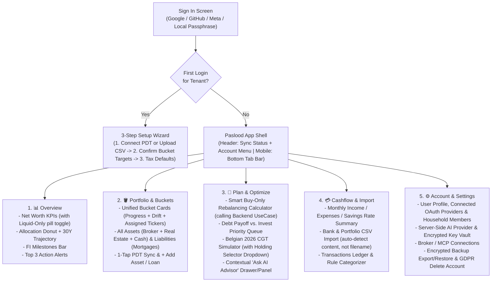

# Paslood — Product UI/UX & Information Architecture Review

- **Date**: 2026-10-25
- **Lenses Applied**: Usability Heuristics (`.agents/skills/ux-heuristics`), Visual Hierarchy & Dark UI (`.agents/skills/refactoring-ui`), Jobs-to-be-Done (`.agents/skills/jobs-to-be-done`)
- **Primary Sources Audited**: `src/paslood/delivery/web/templates/index.html` (3,815 lines), `src/paslood/delivery/web/i18n.py`, `src/paslood/cli.py`
- **Target Context**: Mobile-first remote access (phone over Tailscale/DDNS) + Multi-Tenant SaaS / Self-Hosted IaaS with Social Login (Google, GitHub, Meta).

---

## 1. Executive Summary: Why the App Feels Scattered

Paslood has strong financial calculators (Buy-Only Rebalancing, Debt vs. Invest APR comparison, Belgian 2026 Capital Gains Tax simulator, Loan Amortization estimator, Compound Trajectory), **but the interface is organized around backend storage mechanisms rather than user tasks**:

1. **Holdings & Assets are split across 3 different tabs**:
   - Broker holdings & bucket mapping live at the bottom of **Buckets** (`#tab-buckets`, [index.html:418-447](file:///Users/tiwu/Downloads/paslood/src/paslood/delivery/web/templates/index.html#L418-L447)).
   - Manual assets (Real Estate, Cash) and Mortgages live in **Data & Assets** (`#tab-cashflow`, [index.html:622-684](file:///Users/tiwu/Downloads/paslood/src/paslood/delivery/web/templates/index.html#L622-L684)).
   - Live broker sync (PDT OAuth/MCP) lives inside **Settings** (`#tab-settings`, [index.html:815-895](file:///Users/tiwu/Downloads/paslood/src/paslood/delivery/web/templates/index.html#L815-L895)).
2. **"Guidance" and "AI Advisor" are competing tabs**: Deterministic advice appears in **Overview** ([L359](file:///Users/tiwu/Downloads/paslood/src/paslood/delivery/web/templates/index.html#L359)), again in **Guidance** ([L487](file:///Users/tiwu/Downloads/paslood/src/paslood/delivery/web/templates/index.html#L487)), while generative advice is isolated in **AI Advisor** ([L743](file:///Users/tiwu/Downloads/paslood/src/paslood/delivery/web/templates/index.html#L743)).
3. **First-Run Onboarding Bug (`wizardFinish`)**: The setup wizard writes bucket targets using hardcoded IDs `b-core-etf`, `b-conviction`, `b-gold`, `b-buffer` ([index.html:3708-3727](file:///Users/tiwu/Downloads/paslood/src/paslood/delivery/web/templates/index.html#L3708-L3727)), whereas `ConfigRepository` seeds buckets with IDs `core-etf`, `tech-growth`, `commodities`, `cash-buffer` ([config_repo.py:114-146](file:///Users/tiwu/Downloads/paslood/src/paslood/adapters/repositories/config_repo.py#L114-L146)). Completing the setup wizard creates **4 duplicate buckets** (8 buckets totaling 200% weight!).
4. **Mobile Navigation Friction**: On phone screens, all 6 sections are hidden inside a top-right hamburger drawer ([index.html:195-233](file:///Users/tiwu/Downloads/paslood/src/paslood/delivery/web/templates/index.html#L195-L233)), and core data views rely on 6-to-7-column horizontal-scroll tables.

---

## 2. Complete Feature Inventory & Scattering Map

| Feature | Current Location (`index.html`) | API Route | UX / IA Issue |
| :--- | :--- | :--- | :--- |
| **KPI Cards** (Net Worth, Assets, Debts, Free Cashflow) | `#tab-dashboard` ([L270-296](file:///Users/tiwu/Downloads/paslood/src/paslood/delivery/web/templates/index.html#L270-L296)) | `GET /api/overview` | Good placement; lacks "Last synced / updated" indicator and click-through to underlying assets/debts. |
| **Exclude Property Toggle** | `#tab-dashboard` ([L254-267](file:///Users/tiwu/Downloads/paslood/src/paslood/delivery/web/templates/index.html#L254-L267)) | `GET /api/overview?exclude_property=` | Takes a full-width banner above KPIs; should be a compact pill toggle inside the Net Worth header. |
| **Allocation Donut & 30Y Trajectory** | `#tab-dashboard` ([L299-337](file:///Users/tiwu/Downloads/paslood/src/paslood/delivery/web/templates/index.html#L299-L337)) | `GET /api/projection` | Good, but CAGR/Year controls don't show the assumed monthly savings euro amount used in the curve. |
| **FI Milestones Tracker** | `#tab-dashboard` ([L340-356](file:///Users/tiwu/Downloads/paslood/src/paslood/delivery/web/templates/index.html#L340-L356)) + `#milestones-modal` ([L1376](file:///Users/tiwu/Downloads/paslood/src/paslood/delivery/web/templates/index.html#L1376)) | `GET/POST /api/milestones` | 5-column grid (`lg:grid-cols-5`) stacks into a tall vertical list on mobile. |
| **Immediate Recommendations Preview** | `#tab-dashboard` ([L359-372](file:///Users/tiwu/Downloads/paslood/src/paslood/delivery/web/templates/index.html#L359-L372)) | `GET /api/overview` | Duplicates `#debt-advisor-list` on `#tab-advice` ([L487](file:///Users/tiwu/Downloads/paslood/src/paslood/delivery/web/templates/index.html#L487)). |
| **Strategic Buckets Table & Progress Meters** | `#tab-buckets` ([L388-415](file:///Users/tiwu/Downloads/paslood/src/paslood/delivery/web/templates/index.html#L388-L415)) | `POST/PUT/DELETE /api/buckets` | Table ([L390](file:///Users/tiwu/Downloads/paslood/src/paslood/delivery/web/templates/index.html#L390)) and Progress Meters ([L410](file:///Users/tiwu/Downloads/paslood/src/paslood/delivery/web/templates/index.html#L410)) display the exact same numbers twice on the same screen. |
| **Holdings-to-Bucket Assignment Table** | `#tab-buckets` ([L418-447](file:///Users/tiwu/Downloads/paslood/src/paslood/delivery/web/templates/index.html#L418-L447)) | `POST /api/buckets/assign-asset` | Shows all assets, but you cannot add/edit/delete an asset from here—you have to jump to `#tab-cashflow`. |
| **Smart Buy-Only Deposit Calculator** | `#tab-advice` ([L453-484](file:///Users/tiwu/Downloads/paslood/src/paslood/delivery/web/templates/index.html#L453-L484)) | Client-side JS math (!), not calling `AdviseContributionUseCase` | **Bug/Drift**: Web UI computes contribution orders in inline JS while CLI calls `AdviseContributionUseCase`. Should call a server endpoint `/api/advice/contribution`. |
| **Belgian 2026 CGT Simulator & PDT Lookup** | `#tab-advice` ([L503-609](file:///Users/tiwu/Downloads/paslood/src/paslood/delivery/web/templates/index.html#L503-L609)) | `GET /api/tax/lookup-price`, `POST /api/tax/calculate` | Pre-filled with hardcoded dummy values (`ASML`, `912.00`, `1250.00`, `15` shares) instead of letting the user pick one of their actual portfolio holdings from a dropdown! |
| **Manual Assets & Mortgages CRUD** | `#tab-cashflow` ([L622-684](file:///Users/tiwu/Downloads/paslood/src/paslood/delivery/web/templates/index.html#L622-L684)) | `/api/assets/manual`, `/api/liabilities/manual` | Labelled "Cashflow" in code (`#tab-cashflow`) and "Data & Assets" in nav; mixes Net Worth balance-sheet items with bank statement CSV uploads. |
| **CSV Upload & Transaction Categorization** | `#tab-cashflow` ([L687-739](file:///Users/tiwu/Downloads/paslood/src/paslood/delivery/web/templates/index.html#L687-L739)) | `/api/ingest/kbc`, `/api/ingest/generic`, `/api/transactions/rebucket` | Single dropzone guesses KBC vs Generic CSV by filename (`file.name.includes('kbc')`, [L3663](file:///Users/tiwu/Downloads/paslood/src/paslood/delivery/web/templates/index.html#L3663))—fails if user renames the file! |
| **AI Strategic Advisor** | `#tab-ai` ([L743-805](file:///Users/tiwu/Downloads/paslood/src/paslood/delivery/web/templates/index.html#L743-L805)) | `POST /api/ai/advise` | Single-turn prompt box; doesn't show what anonymized data payload is sent to the LLM (trust gap). |
| **PDT OAuth/MCP Sync, AI Keys, Tax Defaults, Language, Vault Backup** | `#tab-settings` ([L808-1120](file:///Users/tiwu/Downloads/paslood/src/paslood/delivery/web/templates/index.html#L808-L1120)) | `/api/settings`, `/api/auth/pdt/*`, `/api/backup/*` | 5 long stacked cards; PDT Sync button is buried in Settings instead of next to Portfolio Holdings. |
| **First-Time Setup Wizard** | `#setup-wizard-modal` ([L1440-1630](file:///Users/tiwu/Downloads/paslood/src/paslood/delivery/web/templates/index.html#L1440-L1630)) | Multiple | Creates duplicate buckets due to ID mismatch (`b-core-etf` vs `core-etf`); sets `localStorage` flag so it re-triggers on every new device/phone browser. |

---

## 3. Personas, Jobs-to-be-Done (JTBD) & Core Use Cases

### 3.1 Target Personas
1. **Pieter (34, Belgian Tech Professional — Mobile Check-In & Monthly ETF Investor)**:
   - *JTBD*: "When my salary lands on the 25th, help me see my free cashflow and tell me exactly which ETF bucket to buy on Saxo/Bolero in under 2 minutes on my phone, without selling anything or triggering Belgian CGT."
2. **Sofie & Lucas (41, Household Planners — Real Estate + Mortgage + Portfolio)**:
   - *JTBD*: "When we review our family finances together, let us see both our liquid ETF portfolio and our house + KBC mortgage in one place, and simulate whether extra savings should go to early loan payoff or global equities."
3. **Marc (48, Self-Hoster / Privacy-Conscious Investor)**:
   - *JTBD*: "When I run Paslood on my home server/NAS via Docker and Tailscale, let me sign in with Google/GitHub from my phone, keep my AI keys and broker tokens encrypted on my server, and export an encrypted backup."

### 3.2 Core Use Cases & Task-Flow Friction Audit

| Use Case | Current Flow & Friction (Steps) | Target Redesigned Flow (Steps) |
| :--- | :--- | :--- |
| **UC-1: Monthly Payday Buy-Only Rebalance (Phone)** | 1. Open app on phone → 2. Tap hamburger → 3. Tap *Data & Assets* → 4. Upload KBC CSV → 5. Tap hamburger → 6. Tap *Guidance* → 7. Type deposit amount manually → 8. Read bucket names → 9. Tap hamburger → 10. Tap *Buckets* to check which ETF ticker is in that bucket (**10 steps across 3 tabs**). | 1. Open **Plan & Rebalance** on bottom nav (pre-filled with free monthly cashflow) → 2. Tap **Calculate Buy Plan** → 3. Each order card shows the bucket *and* its mapped tickers (`VWCE`, `IWDA`) + 1-tap AI second opinion (**3 steps, 1 screen**). |
| **UC-2: First-Time Onboarding (SaaS or Self-Host)** | Wizard pops up via `localStorage` → Step 1 CSV upload guesses format by filename → Step 2 creates duplicate buckets (`b-core-etf`) → No account identity (**Broken**). | 1. Social Sign-In (Google/GitHub) → 2. Server-stored onboarding state: pick starting template or connect PDT / upload CSV (with explicit format selector) → 3. Confirm 100% bucket weights updating existing seeded buckets (**3 clean steps**). |
| **UC-3: Add/Edit Portfolio Holding & Assign Bucket** | Add asset in *Data & Assets* tab → Switch to *Buckets* tab → Scroll to bottom table → Use dropdown to assign bucket (**2 tabs, 2 tables**). | Unified **Portfolio** tab: "+ Add Asset" modal includes **Bucket dropdown** directly; Holdings list shows value, weight, and bucket badge in one place (**1 tab**). |
| **UC-4: Belgian 2026 CGT Sale Simulation** | Open *Guidance* → Scroll to bottom → Manually type ticker `ASML`, manually type share count, click Lookup PDT → Click Calculate (**Manual data re-entry**). | In **Plan & Rebalance → Tax Optimizer**, select any existing holding from a dropdown → auto-populates ticker, current value, and PDT Dec 31, 2025 benchmark price (**2 clicks**). |
| **UC-5: Sync Live Broker Holdings (PDT)** | Open hamburger → *Settings* → Scroll to PDT card → Click *Sync Holdings* → Switch back to *Overview* (**5 steps**). | Persistent **Sync Now** button in top header / Portfolio tab header with live "Synced 2m ago" badge (**1 tap**). |
| **UC-6: Ask AI Advisor About a Specific Decision** | Go to *AI Advisor* tab → Pick one of 5 generic prompt buttons → Wait for full balance-sheet dump response. | Keep dedicated advisor view **plus** contextual "✨ Ask AI about this" button inside Rebalancing & Tax Simulator cards, with a collapsible "View anonymized data sent to AI" preview. |

---

## 4. Heuristic & Visual Design Audit

### 4.1 Nielsen Heuristic Scorecard

| Heuristic | Score (1–5) | Key Violations & Evidence |
| :--- | :--- | :--- |
| **1. Visibility of System Status** | 3/5 | No global indicator of when bank CSV or PDT holdings were last synced on the Dashboard; default `bunq-savings` (€15,000) is silently pre-seeded ([config_repo.py:178-188](file:///Users/tiwu/Downloads/paslood/src/paslood/adapters/repositories/config_repo.py#L178-L188)), making new users think demo money is real or wonder where €15k came from. |
| **2. Match Between System & Real World** | 3/5 | Nav item `🏦 Data & Assets` has DOM ID `tab-cashflow`; mixes Net Worth Balance Sheet (Real Estate, Mortgages) with Cashflow (Transactions). |
| **3. User Control & Freedom** | 2.5/5 | Manual assets cannot be edited once created (only deleted, [index.html:646](file:///Users/tiwu/Downloads/paslood/src/paslood/delivery/web/templates/index.html#L646), unlike liabilities which have an edit button); no undo on "Reset CSV Cache". |
| **4. Consistency & Standards** | 3/5 | Language switcher offers `EN`, `NL`, `FR`, `DE` in the UI ([index.html:174-177](file:///Users/tiwu/Downloads/paslood/src/paslood/delivery/web/templates/index.html#L174-L177)), while backend `SUPPORTED_LANGUAGES` only verify `en`/`nl` in several flows; notification alerts use browser `alert()`/`confirm()` in 11 places ([L3212, L3227, L3257, L3278, L3369, L3400, L3428, L3460, L3618](file:///Users/tiwu/Downloads/paslood/src/paslood/delivery/web/templates/index.html#L3212)). |
| **5. Error Prevention** | 2/5 | Setup wizard creates duplicate buckets ([L3708](file:///Users/tiwu/Downloads/paslood/src/paslood/delivery/web/templates/index.html#L3708)); CSV dropzone uses `file.name.toLowerCase().includes('kbc')` ([L3663](file:///Users/tiwu/Downloads/paslood/src/paslood/delivery/web/templates/index.html#L3663)) instead of content sniffing or an explicit selector. |
| **6. Recognition Rather Than Recall** | 2.5/5 | Tax simulator requires typing ticker symbols and share counts from memory instead of selecting from loaded holdings; Buy-Only calculator shows bucket names without showing which ETF tickers belong to each bucket. |

### 4.2 Mobile, Visual Hierarchy & Accessibility Findings (`refactoring-ui`)
- **Bottom Navigation Bar Missing on Mobile**: Relying on a top-right hamburger menu (`#btn-mobile-menu`, [L195](file:///Users/tiwu/Downloads/paslood/src/paslood/delivery/web/templates/index.html#L195)) for primary navigation on phones forces two taps in the hardest-to-reach thumb zone for every tab switch. Add a fixed 5-item bottom tab bar (`sm:hidden fixed bottom-0 inset-x-0`) with `pb-20` on `<main>`.
- **Redundant Bucket Table + Meters**: `#tab-buckets` renders a 7-column table ([L390](file:///Users/tiwu/Downloads/paslood/src/paslood/delivery/web/templates/index.html#L390)) immediately followed by `#bucket-meters-container` ([L412](file:///Users/tiwu/Downloads/paslood/src/paslood/delivery/web/templates/index.html#L412)) showing the same data. Merge them into responsive **Bucket Cards** where each card has the progress bar, target vs. actual weight, drift badge, and an expandable list of assigned holdings.
- **Tailwind Play CDN in Production**: `<script src="https://cdn.tailwindcss.com"></script>` ([L22](file:///Users/tiwu/Downloads/paslood/src/paslood/delivery/web/templates/index.html#L22)) parses the 3,815-line DOM in the browser on every page load (~300ms+ main-thread block on mobile phones) and breaks offline PWA usage.

---

## 5. Proposed Information Architecture (Task-Oriented Consolidation)

Consolidate the 6 scattered tabs into **4 core task-oriented views + Settings/Account**, accessible via a top segmented bar on desktop and a persistent bottom tab bar on mobile:



### Mobile Wireframe: Redesigned Overview + Bottom Nav & Unified Portfolio Card

```text
+---------------------------------------+   +---------------------------------------+
| 🧭 Paslood   [🔄 2m] [🌐NL] [👤] |   | 🧭 Portfolio & Buckets     [+ Add ▾]  |
+---------------------------------------+   +---------------------------------------+
| NET WORTH           [x] Liquid Only   |   | [Buckets (4)] [Assets (8)] [Debts (1)]|
| € 142.500,00        +4.2% MoM         |   +---------------------------------------+
| Assets: € 312,5k  •  Debts: € 170,0k  |   | 🔵 Core World ETFs        UNDERWEIGHT |
| Free Cashflow: € 1.650 / mo (34%)     |   | € 62.400  •  43.8% / 50.0% (-€ 8.850) |
+---------------------------------------+   | [████████████░░░░░░] ±3% tol   [Edit] |
| ⚡ NEXT ACTION                        |   |  ├─ VWCE (Saxo)           € 48.200    |
| Buy € 1.500 Core World ETFs (-6.2%)   |   |  └─ IWDA (Bolero)         € 14.200    |
| [ Open Buy-Only Calculator → ]        |   +---------------------------------------+
+---------------------------------------+   | 🟢 High-Conviction Tech      BALANCED |
| 📈 30Y Trajectory  [5Y][10Y][20Y][30Y]|   | € 51.000  •  35.8% / 35.0% (+€ 1.140) |
| (Chart.js responsive canvas)          |   | [██████████████░░░░] ±5% tol   [Edit] |
+---------------------------------------+   +---------------------------------------+
| 📊      🪣       🧭       💳      ⚙️  |   | 📊      🪣       🧭       💳      ⚙️  |
| Home  Portfolio  Plan  Cashflow Prefs |   | Home  Portfolio  Plan  Cashflow Prefs |
+---------------------------------------+   +---------------------------------------+
```

---

## 6. Prioritised UX Recommendations

| ID | Category | Recommendation | Impact | Effort | Suggested GitHub Issue Title |
| :--- | :--- | :--- | :--- | :--- | :--- |
| **UX-01** | Quick Win (Bug) | Fix Setup Wizard bucket IDs (`core-etf`, `tech-growth`, `commodities`, `cash-buffer`) so onboarding updates default buckets instead of creating 4 duplicates totaling 200%. | High | S | `fix(ux): align setup wizard bucket IDs with default seeded buckets` |
| **UX-02** | Quick Win (Bug) | Detect KBC vs. Generic CSV by inspecting file header content (or explicit radio toggle) instead of `file.name.includes('kbc')`; add "Edit" action for manual assets. | High | S | `fix(ingest): auto-detect CSV format from headers and allow editing manual assets` |
| **UX-03** | Quick Win | Remove silent €15,000 `bunq-savings` demo asset from default new-user state; replace with an explicit "Load Demo Portfolio" button on the empty state. | High | S | `feat(ux): replace hardcoded 15k Bunq demo asset with explicit empty state and demo loader` |
| **UX-04** | Quick Win | Populate a "Select from Portfolio Holdings" dropdown in the Belgian 2026 CGT Simulator and show mapped tickers inside Buy-Only Rebalancing recommendations. | High | S | `feat(ux): link holdings dropdown to CGT simulator and show tickers in buy orders` |
| **UX-05** | Next (Mobile) | Add fixed mobile bottom navigation bar (`Overview`, `Portfolio`, `Plan`, `Cashflow`, `Settings`) and replace native `alert()`/`confirm()` calls with non-blocking toast notifications. | High | M | `feat(mobile): add bottom tab bar navigation and toast notification system` |
| **UX-06** | Next (IA) | Consolidate Holdings, Manual Assets, Liabilities, and Buckets into a unified **Portfolio & Buckets** workspace; merge redundant Bucket table + progress meters into responsive Bucket Cards. | High | M | `refactor(ui): unify buckets, holdings, and manual assets/debts into Portfolio workspace` |
| **UX-07** | Strategic (SaaS) | Add branded Social Sign-In page (Google, GitHub, Meta + local fallback), user profile menu, "View anonymized AI prompt" transparency drawer, and server-persisted onboarding state. | High | M | `feat(auth-ui): add OAuth login screen, account menu, and AI prompt transparency drawer` |
