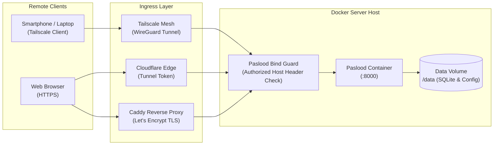

# Self-Hosting & Remote Access Guide

Paslood operates on a local-first, single-owner security model. It stores financial records in a private local database and rejects multi-tenant SaaS operation.

---

## 1. Remote Access Topology



---

## 2. Remote Access Configuration

| Method | Profile | Encryption | Public Port Required |
| :--- | :--- | :--- | :--- |
| **Tailscale** *(Recommended)* | `--profile tailscale` | WireGuard Peer-to-Peer | **No** |
| **Cloudflare Tunnel** | `--profile cloudflared` | TLS Edge Tunnel | **No** |
| **Dynamic DNS (DuckDNS + Caddy)** | `--profile ddns` | Let's Encrypt TLS | Yes (Ports 80/443) |

### Option A: Tailscale (Recommended)

1. Generate an Auth Key in the **Tailscale Admin Console** $\rightarrow$ **Settings** $\rightarrow$ **Keys**.
2. Set configuration in `.env`:
   ```dotenv
   TAILSCALE_AUTHKEY=tskey-auth-...
   PASLOOD_TRUSTED_ORIGINS=https://paslood.your-tailnet.ts.net,http://paslood:8000
   ```
3. Start the container:
   ```bash
   docker compose --profile tailscale up -d
   ```
4. Access securely via `http://paslood:8000`.

---

### Option B: Cloudflare Tunnel

1. Create a Tunnel in the Cloudflare Zero Trust dashboard.
2. Set configuration in `.env`:
   ```dotenv
   CLOUDFLARE_TUNNEL_TOKEN=eyJh...
   PASLOOD_TRUSTED_ORIGINS=https://wealth.example.com
   ```
3. Start the container:
   ```bash
   docker compose --profile cloudflared up -d
   ```

---

### Option C: Dynamic DNS (DuckDNS + Caddy)

1. Register a domain at [duckdns.org](https://duckdns.org).
2. Forward ports `80` and `443` on your router to the host.
3. Set configuration in `.env`:
   ```dotenv
   DUCKDNS_DOMAIN=mywealth
   ACME_EMAIL=admin@example.com
   PASLOOD_TRUSTED_ORIGINS=https://mywealth.duckdns.org
   ```
4. Start the container:
   ```bash
   docker compose --profile ddns up -d
   ```

---

## 3. Authentication & Single-Owner Guard

Paslood enforces single-owner authentication. Multiple OAuth accounts cannot be linked to the same installation.

```dotenv
PASLOOD_ALLOWED_EMAILS=owner@example.com
```

Any login attempt from an unlisted email address is rejected with `403 Forbidden`.

---

## 4. Backup & Restore Procedures

### Backup Execution
```bash
docker run --rm -v paslood_data:/data -v $(pwd):/backup alpine \
  tar czf /backup/paslood-backup-$(date +%Y%m%d).tar.gz -C /data .
```

### Restore Execution
```bash
docker run --rm -v paslood_data:/data -v $(pwd):/backup alpine \
  tar xzf /backup/paslood-backup-YYYYMMDD.tar.gz -C /data
```
